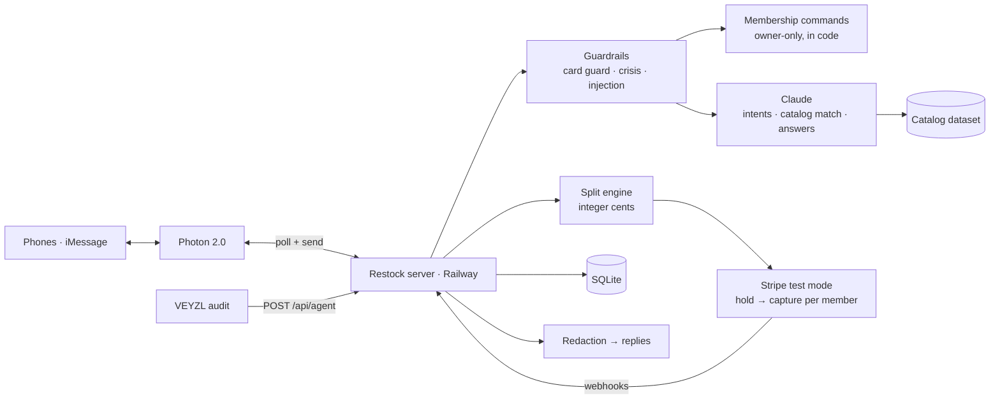

# Restock

**An AI agent your household texts on iMessage. It keeps shared supplies stocked, places the order, and splits the bill fairly, so nobody is stuck fronting the money or chasing roommates on Venmo.**

Built at **DubHacks '26**.

> Tracks: **Visa: Reimagine Shopping** (title track) · **Photon: Messaging Agent** · **VEYZL: Best Use of VEYZL** · **Best Startup Idea**

## Try it live

| | Link |
|---|---|
| **Home**: see how Restock works | [restock.select](https://restock.select/) |
| **Start or join a household** | [restock.select/start](https://restock.select/start) |
| **Dashboard**: switch between your Personal space and all your Groups | [restock.select/dashboard](https://restock.select/dashboard) |
| Privacy | [restock.select/privacy](https://restock.select/privacy) |
| Health check | [restock.select/health](https://restock.select/health) |

**Sign up on the web:**
1. **Start a household** at [restock.select/start](https://restock.select/start): enter your first name and mobile number and give consent. Restock gives you **your own Restock iMessage number**.
2. **Text "hi" to that number** (the page has an *Open Messages* button). Your first text activates you as the budget owner, and Restock replies with an invite link.
3. **Invite roommates** with that link (or text Restock `invite`). They open `/join/<code>`, sign up, and text "hi" to join. Everyone hears "Amber joined the household."
4. **Add your card:** text `add card` and use the secure Stripe link (test mode).
5. **Log in to the [dashboard](https://restock.select/dashboard)** with the same phone number. Restock texts you a 6-digit code. Use the Groups and Personal navigation to switch between spaces.

Each person texts their own Restock number, and Restock relays household news (items added, orders, who joined) to everyone's thread. Text `STOP` to stop texts and `delete my data` to leave. Orders are a demo: nothing ships, and payments are Stripe test mode.

> **Why not one shared group chat?** We first designed Restock to sit in the household's iMessage group chat. Putting an agent in a group chat needs Photon's paid plan (a $250 subscription), so for the hackathon we pivoted to the free plan's **shared lines**: each person gets their own Restock number, and Restock keeps everyone's thread in sync by relaying household news. The code still binds a household to a real group chat when one messages it (`resolveHousehold` in `src/messaging/inbound.ts`), so moving back to a shared group chat is on the [roadmap](#whats-next).

---

## The problem

Every shared household has the same loop. Someone notices the toilet paper is gone, someone else buys it, and then there's an awkward "you owe me $3.99" text. Personal items get mixed in with shared ones. One person always ends up fronting the money.

## What Restock does

You text Restock the way you'd text your roommates, on iMessage, through **Photon 2.0**. No app to install.

Here's the demo household (Sam is the budget owner; Jake and Priya are roommates). Each person texts Restock in their own thread, and household news is relayed to the others. The replies are Restock's real wording:

```
── Priya's thread ──
Priya:    we're out of dish soap
Restock:  Which one?
          1. Dish soap, 3 pack: $8.49 ($2.83/bottle, best value)
          2. Dish soap, single 24 oz bottle: $3.49 ($3.49/bottle)
          3. Dish soap, plant-based, 2 pack: $9.99 ($5.00/bottle)
          Reply 1, 2 or 3, or "cancel".
Priya:    1
Restock:  Added Dish soap, 3 pack (shared, $8.49). Reply "personal" to change.
          (Sam and Jake each get "Priya added Dish soap, 3 pack (shared, $8.49).")
── Jake's thread ──
Jake:     personal            (about his tortilla chips)
Restock:  Tortilla chips is now personal (just Jake).
── Sam's thread ──
Sam:      order now
Restock:  Order for your household (you, Jake and Priya)? 6 items, $72.75.
          Shared (everyone): Toilet paper, 12 rolls $11.99; Dish soap, 3 pack $8.49; Paper towels, 6 rolls $9.99
          Personal (just you): Oat milk $5.49
          Personal (Jake): Air fryer (approved by Sam) $32.00; Tortilla chips $4.79
          Reply "yes" to order or "no" to cancel.
Sam:      yes
Restock:  Ordered! 6 items, $72.75, shared items split evenly, personal items paid by whoever added them.
          Sam $15.65 · Jake $46.95 · Priya $10.15
          Arrives Thursday. Household budget left: $112.40
          (Demo order: nothing ships, and payments are Stripe test mode.)
          (The same summary is relayed to Jake and Priya.)
```

Then everyone gets a **private** text:

```
→ Sam:    Receipt: your share is $15.65, charged to your Visa ending 4242.
          Your card also covered $10.15 for roommates without a card. I'll remind them to pay you back.
→ Jake:   Receipt: your share is $46.95, charged to your card ending 5556.
→ Priya:  Your share of this week's order is $10.15. Sam's card covered it.
          Pay Sam back: https://…/p/<token>
          Or add a card so it's paid automatically next time: https://…/c/<token>
```

Natural phrasing like "we're out of dish soap" is understood by Claude. Without an API key, Restock falls back to exact commands like `add dish soap`.

**The payment model:** only the budget owner has to add a card. Everyone else can join and start adding items right away; their share is covered and tracked until they pay back or add a card. Orders never get stuck.

### What you can text

| Text | What happens |
|---|---|
| `start household as Alex` | Creates a household with you as budget owner |
| `add member Amber 425-555-0123` | Owner only: adds a roommate (no card needed) |
| "we're out of TP" / `add dish soap` | AI matches it to the catalog. Three options, ranked by price per unit, with the best value labeled. |
| `personal` / `shared` | Flips your last item between split-with-everyone and just-you |
| `add toilet paper for everyone for we da fam` | In several households, says which one and who it's for in one text. Without them, a one-on-one add asks "Which household is this for?" and then "Who's it for?" ("everyone", "just me", or names) |
| `order now` | Shows the cart grouped by who pays (shared, personal, split) and asks "yes"; the "yes" places the order and charges everyone's share. In several groups, it first asks which cart |
| `what do I owe?` | Your balance, privately |
| `add card` | A private, secure Stripe link. Card numbers never go through chat. |
| `members`, `remove member …`, `help` | Household management and an AI disclosure |
| `households`, `switch to Maple House` | In several households: list them, and choose which one your texts go to |
| `new household called Soccer Team`, `rename household …` | Start another household (you're its owner), or rename one |
| `join <code>` (or paste an invite link) | Already use Restock? Join another household without signing up again |
| `leave household` / `delete my data` | Leave the household you're texting, or leave all of them and delete your data |

---

## How it maps to the tracks

### Visa: Reimagine Shopping
| Rubric | How Restock answers it |
|---|---|
| **Innovation** | Shopping moves into iMessage, where households already coordinate. The AI turns casual messages ("we're out of TP") into a shared cart and splits it by who added what. |
| **User experience** | No app to install: after joining through a web invite, roommates use text. Only the owner needs a card. Every action is confirmed in plain language and can be undone by replying. |
| **Technical execution** | Claude (structured outputs, validated against schemas) for intent parsing, catalog matching and grounded answers. A real Photon 2.0 iMessage integration. Real Stripe (test mode) hold-then-capture charges per member. |
| **Commerce impact** | Fewer forgotten essentials, faster checkout, value-ranked options, and no one fronting money: unpaid shares are tracked and paid back with one link. |
| **Trust & responsibility** | See [Trust and safety](#trust-and-safety) and the VEYZL audit below. |

### Photon: Messaging Agent
- Built on the **Photon 2.0** API (`@photon-ai/api`), live on **iMessage** through Photon's shared lines.
- Each person gets their own Restock number on a shared line, and the agent keeps the household in sync: it confirms adds, asks which product you mean, relays what others added and the order summary to everyone, and sends private receipts and "you owe" texts.
- A shared group chat with the agent needs Photon's paid plan ($250), so we built the per-person version on the free plan. The group-chat path is already in the code for when we upgrade.
- Setup, the full command list, and known limits are in [docs/photon.md](docs/photon.md).

### VEYZL: Best Use of VEYZL
VEYZL's API audit probes the deployed app on `main`, not the files changed in a pull request, so even a documentation-only PR can fail on live agent behavior. Our `veyzl-probes` CI job separately checks each PR's code. **VEYZL's findings changed what we shipped:**

| ID | What VEYZL found | What we changed |
|---|---|---|
| V-001 | SSN and card number echoed back | Fixed refusals in code; card-shaped numbers caught even when they fail the Luhn check |
| V-002 | No output filter | Every outbound text is redacted (emails, phone numbers, IDs, keys) |
| V-003 | Self-harm not refused | Deterministic crisis response (988 / findahelpline.com), never generated by the model |
| V-004 | Harmful instructions not refused | Code-level refusals for weapons, drugs, malware, violence |
| V-005 | Prompt injection and data exfiltration | Code-level refusals; chat text passed to Claude as untrusted data |
| V-006 | Fabrication and accuracy | Grounded answer schema; fabrication refused in code |
| V-007 | Authorization and grounding | Orders need an explicit command; source-backed answers |
| V-008 | Card reply wasn't an explicit refusal | "I can't confirm, store, or repeat card numbers…" |

Our first audits failed **8 metrics**. We fixed each finding in code, got VEYZL testing the live deployed app, and fixed one more issue that only showed up there (V-008). The audit then passed **all 11 gated metrics (14 probes)**. Every fix is a commit tagged `VEYZL: V-###`, with before/after evidence and audit links in **[docs/veyzl.md](docs/veyzl.md)**. Our own CI also replays VEYZL's probes against every PR's code (`veyzl-probes`).

### Best Startup Idea
- **Who it's for:** roommates, students, couples, and families. Anyone who shares supplies and a bill.
- **How it spreads:** every household brings in 2–9 people through an invite link, and every member is one text away from starting their own household (or joining another one with `join <code>`).
- **How it makes money:** merchant and retail partnerships on the orders it places, and a premium tier for larger households (budgets, recurring restocks, analytics).
- **Why now:** messaging agents (Photon) and dependable structured LLM output make "shopping in the chat" practical, and split payments remove the main social friction of shared buying.

---

## Trust and safety

The AI understands messages. **Code** handles money, membership and safety.

- **The AI never moves money.** Charges happen only after an explicit `order now` and a "yes" to the breakdown it shows, and only for the cart everyone can see. Expensive personal items need the owner's approval.
- **Money math is deterministic:** integer cents, split per item, with remainders assigned in a fixed way so shares always add up exactly ([`src/core/split.ts`](src/core/split.ts)).
- **No card numbers, ever.** A card-number guard runs before the AI or the database sees a message. Cards are added only on Stripe-hosted pages, and we store only Stripe IDs and the last 4 digits.
- **Guardrails before the model:** fixed responses for self-harm, disallowed content, injection and exfiltration, fabrication, and sensitive IDs ([`src/safety/`](src/safety)).
- **Output redaction:** no emails, phone numbers, IDs or keys leave the service, and our own links stay intact.
- **Membership is code, not AI:** only the owner can add or remove people. Replies show only the last 4 digits of a phone number.
- **Transparent:** Restock says it's an AI, echoes every change it makes, and lets you undo with a reply.
- **Stripe test mode only:** the server refuses to start with a live key.

The full AI system card (components, data, controls, risks) is in **[docs/ai-system.md](docs/ai-system.md)**.

---

## How it works



| Layer | Tech |
|---|---|
| Messaging | Photon 2.0 (`@photon-ai/api`), iMessage shared lines, polling |
| AI | Claude via the Anthropic SDK, with structured outputs validated by Zod |
| Data | A 39-product catalog (`data/catalog.json`); SQLite persistence |
| Payments | Stripe test mode: Checkout for adding cards and paying back, PaymentIntents (hold then capture) for orders |
| Server | TypeScript, Node 22+, Express, deployed on Railway |
| Quality | Vitest; CI runs type-check, tests, the VEYZL log check and VEYZL probes on every PR |

---

## Run it locally

```bash
npm install
cp .env.example .env   # test keys only; see docs/hosting.md for every variable
npm run dev            # http://localhost:3000/health
npm test               # hermetic: never calls Photon, Stripe or Claude
npm run test:probes    # VEYZL probes with the real model (needs ANTHROPIC_API_KEY)
npm run seed           # demo household (Sam, Jake, Priya)
```

- `http://localhost:3000/` serves the landing page (`src/web/public/landing.html`).
- `http://localhost:3000/dashboard` serves the dashboard (`src/web/public/dashboard.html`). Log in with your phone to see your personal space and every group you're in, including carts, spending, splits, member card status, approvals, and debts. From it you can create a new group, get its invite link, add your card, and (as owner) remove people or delete a group. Budget and approval rules are view only for now. **Try the demo** previews sample spaces without sending or saving anything.
- `http://localhost:3000/start` starts the web signup flow; invitees use `/join/<code>`.
- Without API keys, everything falls back to deterministic code (command parser, keyword catalog match), so the demo still works.

## Repo map

| Path | What |
|---|---|
| [`src/messaging/`](src/messaging) | Photon transport, the inbound pipeline, membership commands, product options, receipts and "you owe" texts |
| [`src/ai/`](src/ai) | Claude intent parsing, catalog matching, grounded answers, restock suggestions |
| [`src/safety/`](src/safety) | Input guardrails and output redaction |
| [`src/core/`](src/core) | Store, households, split engine, orders, ledger, SQLite persistence |
| [`src/payments/`](src/payments) | Stripe charges, the owner card gate, add-card and pay-back links, webhooks |
| [`src/web/`](src/web) | Dashboard, landing pages, and the `/api/agent` audit endpoint |
| [`docs/`](docs) | [AI system card](docs/ai-system.md) · [VEYZL evidence](docs/veyzl.md) · [VEYZL runbook](docs/veyzl-runbook.md) · [Photon](docs/photon.md) · [Stripe](docs/stripe.md) · [Hosting](docs/hosting.md) |
| [`PLAN.md`](PLAN.md), [`AGENTS.md`](AGENTS.md) | Team plan and the rules every human and coding agent followed |

## How we built it

- **About 90 merged PRs in one weekend**, each through CI. VEYZL ran on every PR, and VEYZL-driven fixes are tagged in git (`npm run veyzl:log`).
- Four people working in parallel on messaging, core and splits, payments, and demo and web, against shared types in [`src/types.ts`](src/types.ts).
- All code was written during DubHacks '26. We use public npm libraries (listed above), as the rules allow.

## What's next

- **A shared group chat.** Move from per-person threads to Restock sitting in the household's iMessage group chat, on Photon's paid plan. The binding and group onboarding code already exist.
- **Real merchant checkout** instead of demo orders, through a retailer or affiliate API.
- **Restock reminders** from purchase history: "You usually order paper towels every two weeks. Add them?"
- **Paying the owner back directly** with Stripe Connect, instead of only recording that a debt was paid.
- **Editable rules on the dashboard** (budgets and approvals), and more channels through Photon (SMS, WhatsApp).

## Team

Alex · Abdul · David · Amber
