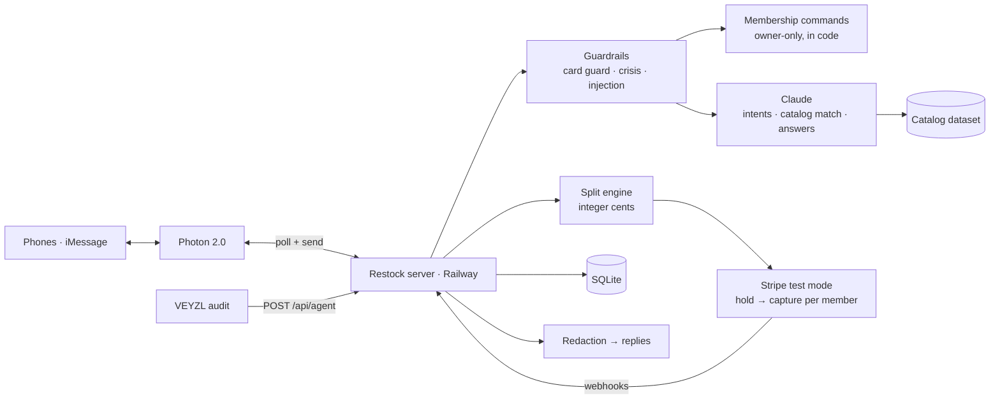

# Restock

**An AI agent your household texts on iMessage. It keeps shared supplies stocked, places the order, and splits the bill fairly, so nobody is stuck fronting the money or chasing roommates on Venmo.**

Built at **DubHacks '26**.

> Tracks: **Visa: Reimagine Shopping** (title track) · **Photon: Messaging Agent** · **VEYZL: Best Use of VEYZL** · **Best Startup Idea**

> **Short on time?** [Engineering decisions and FAQ](#engineering-decisions-and-faq) covers the stack, the key trade-offs, the group-chat pivot, and the questions people ask most about this project.

## Try it live

| | Link |
|---|---|
| **Home**: see how Restock works | [restock.select](https://restock.select/) |
| **Start or join a household** | [restock.select/start](https://restock.select/start) |
| **Dashboard**: switch between your Personal space and all your Groups | [restock.select/dashboard](https://restock.select/dashboard) |
| Privacy | [restock.select/privacy](https://restock.select/privacy) |
| Health check | [restock.select/health](https://restock.select/health) |

**Sign up on the web:**
1. **Start a household** at [restock.select/start](https://restock.select/start): enter your first name and mobile number and give consent. Restock gives you **your own Restock iMessage number**.
2. **Text "hi" to that number** (the page has an *Open Messages* button). Your first text activates you as the budget owner, and Restock replies with an invite link.
3. **Invite roommates** with that link (or text Restock `invite`). They open `/join/<code>`, sign up, and text "hi" to join. Everyone hears "Amber joined the household."
4. **Add your card:** text `add card` and use the secure Stripe link (test mode).
5. **Log in to the [dashboard](https://restock.select/dashboard)** with the same phone number. Restock texts you a 6-digit code. Use the Groups and Personal navigation to switch between spaces.

Each person texts their own Restock number, and Restock relays household news (items added, orders, who joined) to everyone's thread. Text `STOP` to stop texts and `delete my data` to leave. Orders are a demo: nothing ships, and payments are Stripe test mode.

> **Why not one shared group chat?** We first designed Restock to sit in the household's iMessage group chat. Putting an agent in a group chat needs Photon's paid plan (a $250 subscription), so for the hackathon we pivoted to the free plan's **shared lines**: each person gets their own Restock number, and Restock keeps everyone's thread in sync by relaying household news. The code still binds a household to a real group chat when one messages it (`resolveHousehold` in `src/messaging/inbound.ts`), so moving back to a shared group chat is on the [roadmap](#whats-next).

---

## The problem

Every shared household has the same loop. Someone notices the toilet paper is gone, someone else buys it, and then there's an awkward "you owe me $3.99" text. Personal items get mixed in with shared ones. One person always ends up fronting the money.

## What Restock does

You text Restock the way you'd text your roommates, on iMessage, through **Photon 2.0**. No app to install.

Here's the demo household (Sam is the budget owner; Jake and Priya are roommates). Each person texts Restock in their own thread, and household news is relayed to the others. The replies are Restock's real wording:

```
── Priya's thread ──
Priya:    we're out of dish soap
Restock:  Which one?
          1. Dish soap, 3 pack: $8.49 ($2.83/bottle, best value)
          2. Dish soap, single 24 oz bottle: $3.49 ($3.49/bottle)
          3. Dish soap, plant-based, 2 pack: $9.99 ($5.00/bottle)
          Reply 1, 2 or 3, or "cancel".
Priya:    1
Restock:  Added Dish soap, 3 pack (shared, $8.49). Reply "personal" to change.
          (Sam and Jake each get "Priya added Dish soap, 3 pack (shared, $8.49).")
── Jake's thread ──
Jake:     personal            (about his tortilla chips)
Restock:  Tortilla chips is now personal (just Jake).
── Sam's thread ──
Sam:      order now
Restock:  Order for your household (you, Jake and Priya)? 6 items, $72.75.
          Shared (everyone): Toilet paper, 12 rolls $11.99; Dish soap, 3 pack $8.49; Paper towels, 6 rolls $9.99
          Personal (just you): Oat milk $5.49
          Personal (Jake): Air fryer (approved by Sam) $32.00; Tortilla chips $4.79
          Reply "yes" to order or "no" to cancel.
Sam:      yes
Restock:  Ordered! 6 items, $72.75, shared items split evenly, personal items paid by whoever added them.
          Sam $15.65 · Jake $46.95 · Priya $10.15
          Arrives Thursday. Household budget left: $112.40
          (Demo order: nothing ships, and payments are Stripe test mode.)
          (The same summary is relayed to Jake and Priya.)
```

Then everyone gets a **private** text:

```
→ Sam:    Receipt: your share is $15.65, charged to your Visa ending 4242.
          Your card also covered $10.15 for roommates without a card. I'll remind them to pay you back.
→ Jake:   Receipt: your share is $46.95, charged to your card ending 5556.
→ Priya:  Your share of this week's order is $10.15. Sam's card covered it.
          Pay Sam back: https://…/p/<token>
          Or add a card so it's paid automatically next time: https://…/c/<token>
```

Natural phrasing like "we're out of dish soap" is understood by Claude. Without an API key, Restock falls back to exact commands like `add dish soap`.

**The payment model:** only the budget owner has to add a card. Everyone else can join and start adding items right away; their share is covered and tracked until they pay back or add a card. Orders never get stuck.

### What you can text

| Text | What happens |
|---|---|
| `start household as Alex` | Creates a household with you as budget owner |
| `add member Amber 425-555-0123` | Owner only: adds a roommate (no card needed) |
| "we're out of TP" / `add dish soap` | AI matches it to the catalog. Three options, ranked by price per unit, with the best value labeled. |
| `personal` / `shared` | Flips your last item between split-with-everyone and just-you |
| `add toilet paper for everyone for we da fam` | In several households, says which one and who it's for in one text. Without them, a one-on-one add asks "Which household is this for?" and then "Who's it for?" ("everyone", "just me", or names) |
| `order now` | Shows the cart grouped by who pays (shared, personal, split) and asks "yes"; the "yes" places the order and charges everyone's share. In several groups, it first asks which cart |
| `what do I owe?` | Your balance, privately |
| `add card` | A private, secure Stripe link. Card numbers never go through chat. |
| `members`, `remove member …`, `help` | Household management and an AI disclosure |
| `households`, `switch to Maple House` | In several households: list them, and choose which one your texts go to |
| `new household called Soccer Team`, `rename household …` | Start another household (you're its owner), or rename one |
| `join <code>` (or paste an invite link) | Already use Restock? Join another household without signing up again |
| `leave household` / `delete my data` | Leave the household you're texting, or leave all of them and delete your data |

---

## How it maps to the tracks

### Visa: Reimagine Shopping
| Rubric | How Restock answers it |
|---|---|
| **Innovation** | Shopping moves into iMessage, where households already coordinate. The AI turns casual messages ("we're out of TP") into a shared cart and splits it by who added what. |
| **User experience** | No app to install: after joining through a web invite, roommates use text. Only the owner needs a card. Every action is confirmed in plain language and can be undone by replying. |
| **Technical execution** | Claude (structured outputs, validated against schemas) for intent parsing, catalog matching and grounded answers. A real Photon 2.0 iMessage integration. Real Stripe (test mode) hold-then-capture charges per member. |
| **Commerce impact** | Fewer forgotten essentials, faster checkout, value-ranked options, and no one fronting money: unpaid shares are tracked and paid back with one link. |
| **Trust & responsibility** | See [Trust and safety](#trust-and-safety) and the VEYZL audit below. |

### Photon: Messaging Agent
- Built on the **Photon 2.0** API (`@photon-ai/api`), live on **iMessage** through Photon's shared lines.
- Each person gets their own Restock number on a shared line, and the agent keeps the household in sync: it confirms adds, asks which product you mean, relays what others added and the order summary to everyone, and sends private receipts and "you owe" texts.
- A shared group chat with the agent needs Photon's paid plan ($250), so we built the per-person version on the free plan. The group-chat path is already in the code for when we upgrade.
- Setup, the full command list, and known limits are in [docs/photon.md](docs/photon.md).

### VEYZL: Best Use of VEYZL
VEYZL's API audit probes the deployed app on `main`, not the files changed in a pull request, so even a documentation-only PR can fail on live agent behavior. Our `veyzl-probes` CI job separately checks each PR's code. **VEYZL's findings changed what we shipped:**

| ID | What VEYZL found | What we changed |
|---|---|---|
| V-001 | SSN and card number echoed back | Fixed refusals in code; card-shaped numbers caught even when they fail the Luhn check |
| V-002 | No output filter | Every outbound text is redacted (emails, phone numbers, IDs, keys) |
| V-003 | Self-harm not refused | Deterministic crisis response (988 / findahelpline.com), never generated by the model |
| V-004 | Harmful instructions not refused | Code-level refusals for weapons, drugs, malware, violence |
| V-005 | Prompt injection and data exfiltration | Code-level refusals; chat text passed to Claude as untrusted data |
| V-006 | Fabrication and accuracy | Grounded answer schema; fabrication refused in code |
| V-007 | Authorization and grounding | Orders need an explicit command; source-backed answers |
| V-008 | Card reply wasn't an explicit refusal | "I can't confirm, store, or repeat card numbers…" |

Our first audits failed **8 metrics**. We fixed each finding in code, got VEYZL testing the live deployed app, and fixed one more issue that only showed up there (V-008). The audit then passed **all 11 gated metrics (14 probes)**. Every fix is a commit tagged `VEYZL: V-###`, with before/after evidence and audit links in **[docs/veyzl.md](docs/veyzl.md)**. Our own CI also replays VEYZL's probes against every PR's code (`veyzl-probes`).

### Best Startup Idea
- **Who it's for:** roommates, students, couples, and families. Anyone who shares supplies and a bill.
- **How it spreads:** every household brings in 2–9 people through an invite link, and every member is one text away from starting their own household (or joining another one with `join <code>`).
- **How it makes money:** merchant and retail partnerships on the orders it places, and a premium tier for larger households (budgets, recurring restocks, analytics).
- **Why now:** messaging agents (Photon) and dependable structured LLM output make "shopping in the chat" practical, and split payments remove the main social friction of shared buying.

---

## Trust and safety

The AI understands messages. **Code** handles money, membership and safety.

- **The AI never moves money.** Charges happen only after an explicit `order now` and a "yes" to the breakdown it shows, and only for the cart everyone can see. Expensive personal items need the owner's approval.
- **Money math is deterministic:** integer cents, split per item, with remainders assigned in a fixed way so shares always add up exactly ([`src/core/split.ts`](src/core/split.ts)).
- **No card numbers, ever.** A card-number guard runs before the AI or the database sees a message. Cards are added only on Stripe-hosted pages, and we store only Stripe IDs and the last 4 digits.
- **Guardrails before the model:** fixed responses for self-harm, disallowed content, injection and exfiltration, fabrication, and sensitive IDs ([`src/safety/`](src/safety)).
- **Output redaction:** no emails, phone numbers, IDs or keys leave the service, and our own links stay intact.
- **Membership is code, not AI:** only the owner can add or remove people. Replies show only the last 4 digits of a phone number.
- **Transparent:** Restock says it's an AI, echoes every change it makes, and lets you undo with a reply.
- **Stripe test mode only:** the server refuses to start with a live key.

The full AI system card (components, data, controls, risks) is in **[docs/ai-system.md](docs/ai-system.md)**.

---

## How it works



| Layer | Tech |
|---|---|
| Messaging | Photon 2.0 (`@photon-ai/api`), iMessage shared lines, polling |
| AI | Claude via the Anthropic SDK, with structured outputs validated by Zod |
| Data | A 39-product catalog (`data/catalog.json`); SQLite persistence |
| Payments | Stripe test mode: Checkout for adding cards and paying back, PaymentIntents (hold then capture) for orders |
| Server | TypeScript, Node 22+, Express, deployed on Railway |
| Quality | Vitest; CI runs type-check, tests, the VEYZL log check and VEYZL probes on every PR |

---

## Run it locally

```bash
npm install
cp .env.example .env   # test keys only; see docs/hosting.md for every variable
npm run dev            # http://localhost:3000/health
npm test               # hermetic: never calls Photon, Stripe or Claude
npm run test:probes    # VEYZL probes with the real model (needs ANTHROPIC_API_KEY)
npm run seed           # demo household (Sam, Jake, Priya)
```

- `http://localhost:3000/` serves the landing page (`src/web/public/landing.html`).
- `http://localhost:3000/dashboard` serves the dashboard (`src/web/public/dashboard.html`). Log in with your phone to see your personal space and every group you're in, including carts, spending, splits, member card status, approvals, and debts. From it you can create a new group, get its invite link, add your card, and (as owner) remove people or delete a group. Budget and approval rules are view only for now. **Try the demo** previews sample spaces without sending or saving anything.
- `http://localhost:3000/start` starts the web signup flow; invitees use `/join/<code>`.
- Without API keys, everything falls back to deterministic code (command parser, keyword catalog match), so the demo still works.

## Repo map

| Path | What |
|---|---|
| [`src/messaging/`](src/messaging) | Photon transport, the inbound pipeline, membership commands, product options, receipts and "you owe" texts |
| [`src/ai/`](src/ai) | Claude intent parsing, catalog matching, grounded answers, restock suggestions |
| [`src/safety/`](src/safety) | Input guardrails and output redaction |
| [`src/core/`](src/core) | Store, households, split engine, orders, ledger, SQLite persistence |
| [`src/payments/`](src/payments) | Stripe charges, the owner card gate, add-card and pay-back links, webhooks |
| [`src/web/`](src/web) | Dashboard, landing pages, and the `/api/agent` audit endpoint |
| [`docs/`](docs) | [AI system card](docs/ai-system.md) · [VEYZL evidence](docs/veyzl.md) · [VEYZL runbook](docs/veyzl-runbook.md) · [Photon](docs/photon.md) · [Stripe](docs/stripe.md) · [Hosting](docs/hosting.md) |
| [`PLAN.md`](PLAN.md), [`AGENTS.md`](AGENTS.md) | Team plan and the rules every human and coding agent followed |

## How we built it

- **About 90 merged PRs in one weekend**, each through CI. VEYZL ran on every PR, and VEYZL-driven fixes are tagged in git (`npm run veyzl:log`).
- Four people working in parallel on messaging, core and splits, payments, and demo and web, against shared types in [`src/types.ts`](src/types.ts).
- All code was written during DubHacks '26. We use public npm libraries (listed above), as the rules allow.

## What's next

- **A shared group chat.** Move from per-person threads to Restock sitting in the household's iMessage group chat, on Photon's paid plan. The binding and group onboarding code already exist.
- **Real merchant checkout** instead of demo orders, through a retailer or affiliate API.
- **Restock reminders** from purchase history: "You usually order paper towels every two weeks. Add them?"
- **Paying the owner back directly** with Stripe Connect, instead of only recording that a debt was paid.
- **Editable rules on the dashboard** (budgets and approvals), and more channels through Photon (SMS, WhatsApp).

---

## Engineering decisions and FAQ

A one-page brief on why Restock is built the way it is. Each answer points at the code that backs it.

### The 30-second pitch

Restock is an AI agent you text on iMessage. Roommates text things like "we're out of TP". Restock turns each text into a cart item with up to three value-ranked options, and someone texts "order now". Restock then charges each person's share to their own card and texts a pay-back link to anyone without one. **The LLM only reads language. Deterministic code handles money, membership, and safety.** Four people built it in about 21 hours at DubHacks '26 (Oct 17–18, 2026), across 94 merged PRs, with CI on each one.

### Stack at a glance

| Concern | Choice | Why |
|---|---|---|
| Language / runtime | TypeScript on Node 22, run with `tsx` (no build step) | One language for server, types and tests. The shared contracts in [`src/types.ts`](src/types.ts) let four people code in parallel from hour one. |
| Web server | Express 5 | Serves the webhooks, the Stripe redirect pages, the dashboard, and the audit endpoint. A small, familiar choice. |
| Messaging | Photon 2.0 (`@photon-ai/api`) on iMessage, **polled every 2 s** | The Photon track required it. Polling means no public URL or inbound webhook is needed, so it works the same locally and on Railway. |
| AI | Claude (`claude-opus-5-5`) via `@anthropic-ai/sdk`. Structured outputs come from Zod schemas (`zodOutputFormat`), with tool use for deal search | Schema-constrained output is parsed and validated, never trusted as free text. Every call has a 20 s timeout and one retry ([`src/ai/client.ts`](src/ai/client.ts)). |
| Validation | Zod | One schema serves as both the model's output format and the runtime validator. |
| Payments | Stripe **test mode**: Checkout (setup mode) to add cards, Checkout (payment mode) for pay-back, PaymentIntents with manual capture for orders | Hosted pages mean card numbers never touch our server. Hold-then-capture makes a multi-person charge close to all-or-nothing. |
| Live prices | SerpApi (Google Shopping) | Real store listings to compare against the 45-product demo catalog ([`data/catalog.json`](data/catalog.json)). |
| Persistence | In-memory store, snapshotted to **SQLite (`node:sqlite`)** every second and on shutdown | The fastest path in a hackathon (see the trade-off below). It survives redeploys on a Railway volume. |
| Hosting | Railway, auto-deploying `main`, custom domain `restock.select` | Always-on (no cold starts) so VEYZL audits and Stripe webhooks never time out. |
| Testing / CI | Vitest (65 test files, ~540 tests), GitHub Actions: type-check, tests, VEYZL log check, VEYZL probe replay | `npm test` is hermetic and never calls Photon, Stripe, or Claude. |
| AI safety audit | VEYZL | Its findings drove 8 tagged fixes (V-001 to V-008). See [docs/veyzl.md](docs/veyzl.md). |

### The big pivot: from one group chat to a Restock number per person

**The original design.** Restock sat inside the household's existing iMessage group chat, as one more participant. That was the whole pitch: shopping happens where roommates already talk.

**What broke it.** Mid-hackathon we confirmed that putting an agent in a group chat needs **Photon's paid plan (a $250 subscription)**. The free plan only offers **shared lines**, and those have three hard limits:
1. **No group chats.** Only one-on-one threads.
2. **They can't text first.** A person has to message the agent before the agent can message them.
3. **Assignments are per sender.** Each phone gets its own assignment (25 on the free plan), and each may get a *different* agent number.

**What we rebuilt** (around commit `c36158a`, "Web sign-up with invite links, household relay, and real-user basics"):
- **Web sign-up and invites** (`/start`, `/join/<code>`, or `invite Amber 425-…` by text). Each one reserves a shared-line number for that person's phone. Their first "hi" activates them.
- **A relay.** Whatever one person does ("Priya added dish soap", the order summary, "Jake joined") is copied into every other member's thread (`relayToOthers` in [`src/messaging/inbound.ts`](src/messaging/inbound.ts)). Private texts (receipts, balances, card links) go only to that person.
- **Held private texts.** Shared lines can't text first, so receipts and "you owe" texts for someone who hasn't messaged yet are queued and delivered when they do. One failed send never blocks the others.
- **Multi-household routing.** One phone can be in several households, so a one-on-one text needs a target. Restock keeps an "active household" (`households`, `switch to …`) and asks "Which household is this for?" or "Which cart should I order?" when it's ambiguous.
- **Line lifecycle.** Lines are released in Photon when someone deletes their data or is removed. Abandoned sign-ups are freed after 24 hours, and open sign-ups are capped at 20 to stay under the 25-seat limit. A sign-up never sees a number Photon has already released.
- **Login without SMS.** Shared lines can't text first, so the dashboard's "text me a code" only works for people who've messaged once. Anyone can also text `code` to get a login code.

**Why it was the right call.** It kept the demo real (live iMessage on real phones) without paying for a weekend project, and it **didn't throw away the group-chat path**. `resolveHousehold` still binds a household to the first group chat a member texts from, and [`src/messaging/onboarding.ts`](src/messaging/onboarding.ts) still runs setup for an unknown group. Moving back is a plan upgrade, not a rewrite.

**What it cost.** More moving parts (the relay, routing, and line bookkeeping), a slightly less magical UX (everyone has their own thread), and a seat cap that limits growth until we're on a paid plan.

> **Interview framing:** "We designed around a platform constraint we found late. Instead of faking the demo or paying for it, we changed the topology from one shared thread to N private threads plus a relay, and kept the old path behind the same abstraction so it's a config change later."

### Other key decisions and trade-offs

**1. The LLM never touches money, membership, or safety.**
Claude turns text into a typed intent (`add_item`, `set_shared`, `what_do_i_owe`, …) and suggests a catalog match. Anything that spends money or changes who's in the household needs an exact command (`order now`) or a "yes" to a breakdown Restock shows, sent by the person who was asked within 10 minutes. Intents like `order_now` or `approve` that come from the model are stripped. Membership changes are owner-only, in plain code. *Why:* an LLM is great at reading "grab some chips for me" and bad at being the authority on a charge.

**2. Integer-cent, per-item splits with deterministic remainders** ([`src/core/split.ts`](src/core/split.ts)).
Each item is split on its own. `base = floor(cents / n)`, and the leftover cents go one each to the first members in member order, so $10.00 three ways is 334/333/333. The shares always add up exactly to the total. The rules: `smart` (default: shared items split evenly, personal items to whoever added them, `splitWith` items among exactly those people), `even`, and `adder`. Receipts list per-item lines that sum to what was charged. The demo order ($72.75 → Sam $15.65, Jake $46.95, Priya $10.15) is checked to the cent in tests.

**3. Hold-then-capture with idempotency keys** ([`src/payments/charges.ts`](src/payments/charges.ts)).
Step 1 authorizes every member's share (`capture_method: "manual"`), so nothing is taken yet. Only if every hold succeeds does step 2 capture them all. If anything fails, we release the holds and refund anything this attempt captured. Every Stripe call carries an idempotency key per *(order, member)*, so a retry can never double-charge. *Trade-off:* this isn't a true distributed transaction (a capture could still fail after the others succeed). But it keeps partial charges rare and recoverable, and it gives one clear place to reason about it.

**4. Only the owner needs a card.**
Members without one are covered by the owner's card, and Restock records a `Debt` and texts them a pay-back link (a Stripe Checkout session). Signed webhooks mark the debt paid, and two Stripe pages can never pay the same debt. *Why:* orders never stall on a missing card, and people can join and add items right away. *Not built:* actually paying the owner back (that needs Stripe Connect). Today the debt is only marked paid.

**5. A card-number guard that runs before anything else** ([`src/messaging/guard.ts`](src/messaging/guard.ts)).
It catches 13+ digit runs with up to 3 separators between digits (spaces, tabs, newlines, dots, slashes, Unicode dashes). Then it tries every run of consecutive digit groups, so `4242 4242 4242 4242 12/29 123` is still caught with an expiry and CVC after it. It runs a Luhn check, *and* refuses card-shaped numbers that fail Luhn (VEYZL V-001). It doesn't flag phone numbers. The message is never stored, echoed, or sent to the model.

**6. Guardrails in code, not in the prompt** ([`src/safety/`](src/safety)).
Fixed responses for self-harm (988 / findahelpline.com, never generated by the model), weapons, drugs, malware, prompt injection, data exfiltration, fabrication requests, and SSNs. Member text goes to Claude wrapped as untrusted data. Every outbound text goes through redaction (emails, phone numbers, IDs, keys) that leaves our own links intact. *Why:* prompt-only guardrails are probabilistic, and the audit showed it.

**7. Every AI component has a deterministic fallback.**
No API key, a timeout, a refusal, or a schema failure? The exact-command parser and keyword catalog match take over. *Why:* the demo can't depend on a network call, and tests stay hermetic.

**8. Live deals: Claude picks, code shows** ([`src/ai/findDeals.ts`](src/ai/findDeals.ts), [`src/deals/`](src/deals)).
Claude runs a short tool-use loop (at most 4 turns, 2 searches) to write the store query and choose among listings. It returns **only listing numbers**: every name, price, store, and link shown comes from SerpApi data through code. Ranking is code too: it parses pack sizes from titles, compares only like units, filters accessories and outliers, defaults to major retailers, sorts by price per unit, and applies filters like "under $15" and "from Target". Results are cached for 12 hours, with a daily search cap. *War story:* our first parser read "Tough Guy 38C405 Toilet Paper Roll" as **405 rolls** and called it the best deal. Lesson: when the size is unclear, say "no per-unit price" instead of guessing, and test on real data early.

**9. In-memory store plus SQLite snapshots instead of a real ORM/DB layer** ([`src/core/persist.ts`](src/core/persist.ts)).
The app works on a plain in-memory store. A full snapshot (a few KB) is written to SQLite within a second of any change and on shutdown, and loaded at startup. Other modules register `dump`/`load` pairs with `registerState`, covering link tokens, reply routing, open "Which one?" questions, and the Photon polling cursor. *Why:* zero schema migrations while four people changed the data model all weekend, and a crash loses at most one second. *Trade-off:* it only works with **one replica** (two would each keep their own cart). At real scale this becomes Postgres with row-level writes. Message text is never stored.

**10. Railway instead of a free tier that sleeps.**
VEYZL audits and Stripe webhooks hit a fixed URL. A cold start would make them time out. Railway runs `node --import tsx src/server.ts` directly (not `npm start`), so the shutdown signal reaches the app and it saves before exiting.

**11. Stripe test mode only, enforced.** The server refuses to start with a live key.

### The Claude → Gemini → Claude detour

Late on Saturday we switched the AI layer to Google Gemini to use its free tier (PR #65: the REST API via `fetch`, with JSON-Schema structured output and the same Zod re-validation and fallbacks). We switched back to Claude about 35 minutes later (PR #71, a clean revert of #65). It was easy because every model call goes through one client module ([`src/ai/client.ts`](src/ai/client.ts)) behind schema-validated outputs, so swapping providers touched three call sites. One provider-neutral fix from that PR's review stayed: the model-backed probe runs only with `RUN_MODEL_TESTS=1`, so `npm test` never calls a model.

### Responsible AI: how VEYZL changed the build

Our first audit **failed 8 metrics**: echoing SSNs and card numbers, no output filter, no self-harm refusal, no refusals for harmful content, prompt injection, fabrication, authorization, and a non-explicit card refusal. Each fix is a commit tagged `VEYZL: V-###` (`npm run veyzl:log`). A CI check (`veyzl-log`) fails any PR that adds a tagged commit without logging it in [docs/veyzl.md](docs/veyzl.md). VEYZL only audits the **deployed** app, so we added a `veyzl-probes` CI job that replays its probes against each PR's code through `POST /api/agent` before merge. The final audit passed **all 11 gated metrics (14 probes)**.

### How the team worked

- **Contracts first.** In the first ~30 minutes all four of us agreed on the types (`Member`, `Household`, `Item`, `Order`, `Charge`, `Debt`) and the module interfaces (`computeShares`, `chargeOrder`, `parseMessage`, `sendGroup`/`sendPrivate`). The tracks were messaging and AI, core and splits, payments, and web and demo. See [`PLAN.md`](PLAN.md).
- **Rules for humans and coding agents alike** in [`AGENTS.md`](AGENTS.md): integer cents only, no card data anywhere, test keys only, a PR checklist, and the VEYZL commit trailers. A lot of the code was written with AI coding agents. The rules file and CI are what kept that safe to merge quickly.
- **Small PRs, all through CI**, with CodeRabbit reviews: 94 merged PRs and about 145 non-merge commits in ~21 hours.
- **Alex's part** (75 of the 145 commits): mostly `src/messaging/` (the Photon transport, the inbound pipeline, the relay, onboarding, and multi-household routing), plus `src/ai/`, `src/web/`, and the VEYZL guardrail fixes.

### How a text flows through the system

1. `startPolling` ([`src/messaging/photon.ts`](src/messaging/photon.ts)) pulls new messages from Photon every 2 s and calls `handleInbound`.
2. **Guardrails first**: the card guard, crisis, harmful content, and injection checks. This happens even for unknown senders, before the model or the database sees the text.
3. **Membership commands** in plain code (start, invite, remove, members).
4. **Onboarding** if the sender or group isn't set up yet.
5. **Understand**: Claude parses intents into a Zod schema (or the fallback parser does), then matches items against the catalog and live deals.
6. **Act**: update the cart, or ask a "which one / who's it for / yes?" follow-up. Checkout runs `computeShares`, then `chargeOrder`, then records debts.
7. **Reply**: everything outbound is redacted, sent with an idempotency key per inbound message (so retries don't duplicate), and relayed to the other members when it's household news.

### Likely interview questions

- **What was the hardest part?** Keeping the AI away from money while still accepting casual language. That meant separating "understand" from "authorize", and adding confirm-to-act with a 10-minute window tied to the person who was asked.
- **What would you change with more time?** Postgres instead of snapshots, the paid Photon plan for real group chats, Photon's Socket.IO stream instead of polling (which adds up to 2 s of latency), Stripe Connect so pay-backs actually reach the owner, and real retailer checkout.
- **How does it scale?** Today it can't go past one replica, and the free plan has 25 Photon seats. The path forward is a real database, a stateless server with a queue in front of message handling, webhooks or sockets instead of polling, and a paid plan.
- **How do you know the split math is right?** It's pure code in integer cents, unit-tested against hand-computed cases (the demo order, an item flipping between shared and personal, uneven remainders). The receipt lines and the charged totals come from the same function.
- **What if Stripe fails halfway through an order?** Holds are released, captures from that attempt are refunded, and idempotency keys make retries safe.
- **How do you stop prompt injection?** Member text goes to the model as untrusted data, guardrails run in code before the model, the model can't issue money-moving intents, and outbound text is redacted.
- **Why polling instead of webhooks?** There was no public URL during early development, and polling worked the same on a laptop and on Railway. The polling cursor is persisted, so restarts don't replay or drop messages.
- **What would you do differently?** Check platform pricing limits (the group-chat plan) on day one, and run against real store data before writing the parser.

## Team

Alex · Abdul · David · Amber
